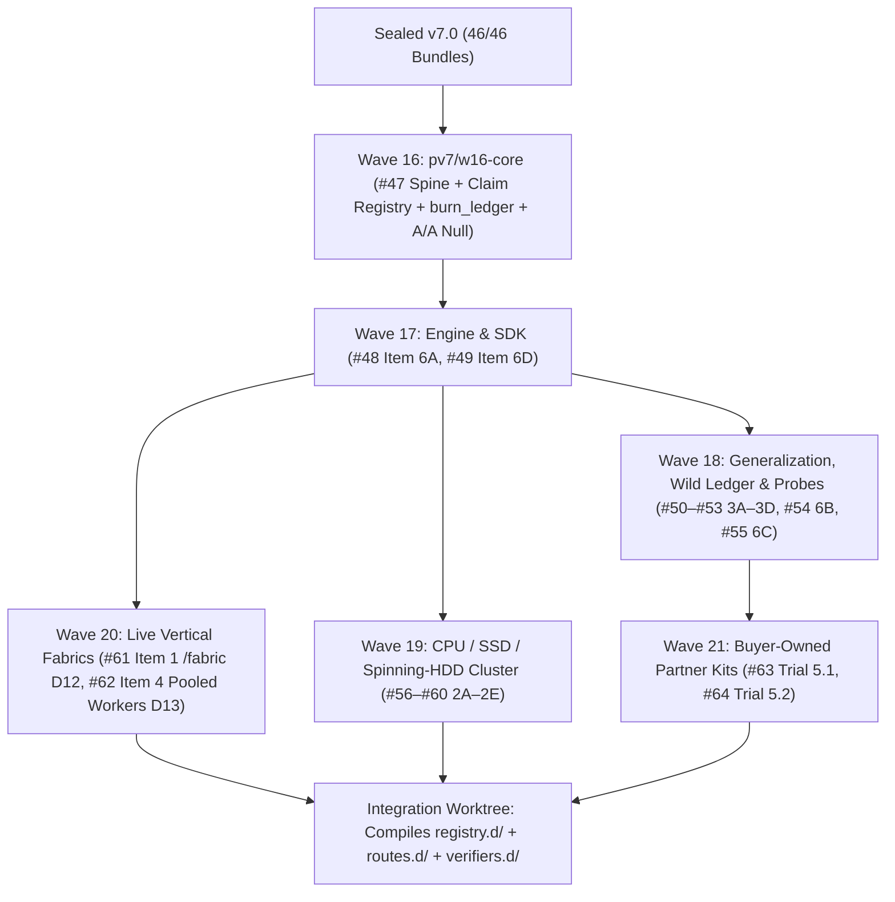

# Post-`v7.0` Additive Multi-Branch Master Plan (`Waves 16–21`, Bundles `#47–#64`)
## Synthesized from 2-Round `$panel-of-experts` Cross-Model Review (`Fable 5.2 Medium` + `Astra 6.2 Medium` + `Carbon 4 Medium`)

> [!IMPORTANT]
> **100% Additive Retention & Hard Sequencing Lock**
> - **Zero Tracks Pruned or Parked:** Every single sub-track across `Queued Items 1–6` is retained (`17` empirical bundles `#48–#64` + `#47` `Wave 16-Core` engineering & calibration spine = **`18` total bundles `#47–#64`**).
> - **Strict Release Gate:** Execution opens **only after** `v6.0` (`Waves 11–13`, `45/45` bundles) and `v7.0` (`Waves 14–15`, `/formal` Lean 4 + `Demo D11 / PM-6`, `46/46` bundles) seal, push, and `.7z`-vault.
> - **Anti-"Muddy-Waters" Guarantee:** Bundle IDs `#47–#64` are permanently pre-reserved before any data runs and **never vacated or reassigned**. Any track that ties or misses its pre-registered threshold seals permanently as `verified-loss` under its own bundle ID, eliminating post-hoc cherry-picking across the 17 empirical lanes.

### Panel Provenance (2 Rounds Complete)
- **Round 1 (`Fable 5.2 Medium`):** [post_v7_panel_r1_fable52_medium.md](file:///C:/Users/mattm/.t3/userdata/providers/antigravity/ac0a3dfd6dddb20962cecff6ee5fe65e19d3923be20e52c5ab52ff877f7e4c32/antigravity-acp/brain/d68f68df-2385-4788-8983-e239ca3c27e0/scratch/post_v7_panel_r1_fable52_medium.md)
- **Round 1 (`Astra 6.2 Medium`):** [post_v7_panel_r1_astra62_medium.md](file:///C:/Users/mattm/.t3/userdata/providers/antigravity/ac0a3dfd6dddb20962cecff6ee5fe65e19d3923be20e52c5ab52ff877f7e4c32/antigravity-acp/brain/d68f68df-2385-4788-8983-e239ca3c27e0/scratch/post_v7_panel_r1_astra62_medium.md)
- **Round 1 (`Carbon 4 Medium`):** [post_v7_panel_r1_carbon4_medium.md](file:///C:/Users/mattm/.t3/userdata/providers/antigravity/ac0a3dfd6dddb20962cecff6ee5fe65e19d3923be20e52c5ab52ff877f7e4c32/antigravity-acp/brain/d68f68df-2385-4788-8983-e239ca3c27e0/scratch/post_v7_panel_r1_carbon4_medium.md)
- **Round 2 (`Fable 5.2 Medium` Cross-Examining `Astra 6.2`):** [post_v7_panel_r2_fable52_medium.md](file:///C:/Users/mattm/.t3/userdata/providers/antigravity/ac0a3dfd6dddb20962cecff6ee5fe65e19d3923be20e52c5ab52ff877f7e4c32/antigravity-acp/brain/d68f68df-2385-4788-8983-e239ca3c27e0/scratch/post_v7_panel_r2_fable52_medium.md)
- **Round 2 (`Astra 6.2 Medium` Cross-Examining `Fable 5.2`):** [post_v7_panel_r2_astra62_medium.md](file:///C:/Users/mattm/.t3/userdata/providers/antigravity/ac0a3dfd6dddb20962cecff6ee5fe65e19d3923be20e52c5ab52ff877f7e4c32/antigravity-acp/brain/d68f68df-2385-4788-8983-e239ca3c27e0/scratch/post_v7_panel_r2_astra62_medium.md)

---

## 1. Hub-and-Spoke Git Topology & Permanent Bundle Reservations (`Waves 16–21`, `#47–#64`)

### 1.1 Zero-Collision Fragment Contract (Eliminates Hot-File Merge Conflicts)
In `Wave 16` (`pv7/w16-core`, `#47`), convert the three shared trunk files once into fragment loaders so spoke branches **only add files**:
1. **`docs/research/registry.d/<id>-<slug>.json`** $\to$ compiled into `verified_registry.json` by the integration worktree (`status` $\in$ `{"verified-pass", "verified-loss", "unsupported", "protocol-ready"}`; duplicate IDs, escaping paths, or mismatched `#47` spine wheel digests fail closed).
2. **`demo_workbench/routes.d/<id>-<slug>.json`** $\to$ declarative route mounts loaded by `demo_workbench/server.py`.
3. **`scripts/verifiers.d/<id>_verifier.py`** $\to$ enumerated automatically by `scripts/verify_all_offline.py`.

### 1.2 Canonical Publication & Bundle Table (`1` Spine + `17` Empirical Bundles)

| Wave | Bundle ID | Track | Spoke Worktree Branch | Claim Tier |
| :--- | :--- | :--- | :--- | :--- |
| **Wave 16** | **`#47`** | **Core Spine + Claim Registry + `burn_ledger` + `A/A` Null Calibration** | `pv7/w16-core` | **`T0` Engineering / Calibration** *(not counted as an empirical win)* |
| **Wave 17** | **`#48`** | **Item 6A:** HNSW Pre-Filter Pushdown (`<35 ms` p95 @ `90%`) + Lazy `EK5` Reason Canonicalizer | `pv7/t6a-engine-closure` | **`T2`** Systems Closure + **`T0`** Reason Parity |
| **Wave 17** | **`#49`** | **Item 6D:** Zero-Services `chelated-kernel` Wheel + Blinded Multi-Family Cold-Start Benchmark | `pv7/t6d-sdk-coldstart` | **`T1` / Gate** Pure-IP Adoption & Isolation |
| **Wave 18** | **`#50`** | **Item 3A:** `gBench` `LOFT SciFact` Pilot + Disjoint Corpus `PM-2` Exact Tango NI (`-0.0500`) | `pv7/t3a-zero-write-ni` | **`T1`** Confirmatory Core Claim |
| **Wave 18** | **`#51`** | **Item 3B:** `gBench` `BEAM 128K` (`20` Convs) + Paired Derivative-vs-Independent Withdrawal | `pv7/t3b-beam-memory` | **`T3`** Exploratory + **`T0`** Incremental Parity |
| **Wave 18** | **`#52`** | **Item 3C:** `QSCCI` Planted Positive Control + `k=1` Native Neuron vs. SAE Latent (`Qwen3.5-2B`) | `pv7/t3c-qscci-singleton` | **`T3`** Mechanistic Probe |
| **Wave 18** | **`#53`** | **Item 3D:** Post-`W14B` `PM-6` Observational Shadow Probe (`1`-Unit & `4`-Unit, $N \ge 300$ Benign) | `pv7/t3d-pm6-shadow` | **`T3`** Observational Probe |
| **Wave 18** | **`#54`** | **Item 6B:** Zero-Retune `12`-Domain + `4`-Hop (`v1->v5`) + Prompt-Shift & Anchor-Poisoning Gauntlet | `pv7/t6b-12domain-4hop` | **`T1`** Confirmatory Core Claim |
| **Wave 18** | **`#55`** | **Item 6C:** Wild `NVD/GHSA/OSV/VEX` + SEC `8-K` Item 4.02 vs. Independent Postgres 17 Ledger | `pv7/t6c-wild-revisions` | **`T1`** Confirmatory Core Claim |
| **Wave 19** | **`#56`** | **Item 2A:** `Qwen3-30B-A3B` CPU Disk-MoE + `0.6B` Speculative Draft (`8 GiB` `cgroup`) | `pv7/t2a-disk-moe` | **`T2`** Reference Hardware Architecture |
| **Wave 19** | **`#57`** | **Item 2B:** `250`-Payload (`1,000`-Catalog) Cartridge Array + `EK5 v3` Revocation (`6 GiB` `cgroup`) | `pv7/t2b-cartridge-array` | **`T2`** Reference Hardware + **`T0`** Fence |
| **Wave 19** | **`#58`** | **Item 2C:** `9.47M` Real Cold-OSD Zero-Rewrite RAG (`4 GiB` `cgroup` vs. `IVF-SQ8` & `Qdrant`) | `pv7/t2c-cold-osd-9m` | **`T2`** Reference Hardware Architecture |
| **Wave 19** | **`#59`** | **Item 2D:** Strictly `< 1 GiB` (`MemoryMax=960M`) CPU Shared-Memory `IQ-04` 7-Arm Appliance | `pv7/t2d-sub1gib-iq04` | **`T2`** Reference Hardware Architecture |
| **Wave 19** | **`#60`** | **Item 2E:** Prefix-Bound `TRA-1` + `EK5` SSD KV/Prefix Cache Across `20` Git Repos $\times$ `50` Commits | `pv7/t2e-ssd-kv-repos` | **`T2`** Reference Hardware Architecture |
| **Wave 20** | **`#61`** | **Item 1 (`Demo D12`):** `/fabric` Autonomous DPU/Switch & Multi-Tranche LEO Control Plane | `pv7/t1-fabric-dpu-leo` | **`T2`** Vertical Reference Architecture |
| **Wave 20** | **`#62`** | **Item 4 (`Demo D13`):** Pooled-Agent Loops (`1,2,4,8` Workers) Under Encoder Change & Withdrawal | `pv7/t4-pooled-workers` | **`T2`** Vertical Reference Architecture |
| **Wave 21** | **`#63`** | **Item 5.1 (Trial 1 Kit):** Search-Operator Migration Charter, `Procrustes+CSLS` Challenger & Scorer | `pv7/t5a-partner-search` | **`T4`** `protocol-ready` (Awaits Buyer Run) |
| **Wave 21** | **`#64`** | **Item 5.2 (Trial 2 Kit):** Records-Owner Natural-Base-Rate Charter, SQL Ledger & Loss Scorer | `pv7/t5b-partner-records` | **`T4`** `protocol-ready` (Awaits Buyer Run) |

---

## 2. `Wave 16-Core` (`#47`) Shared Foundational Spine (Build Once, Reuse Everywhere)

1. **`burn_ledger` (Mechanical Dataset/Query Exposure Gate):**
   - Scans every historical script, cache, and manifest across `Waves 1–15` and hashes all touched corpus IDs, document SHA-256s, and query stems.
   - **Already Verified Catch:** [run_wave11_d10_5m_real_cutover_and_70b_scale.py](file:///D:/GITHUB/CHELATEDAI-STAGE0-NIGHT1/scripts/run_wave11_d10_5m_real_cutover_and_70b_scale.py#L106-L114) burned `msmarco`, `quora`, `fiqa`, `scidocs`, `arguana`, `scifact`, and `nfcorpus`. Any collision (including PubMed abstract overlap between `BioASQ` and `NFCorpus`) fails closed before scoring.
2. **Independently Implemented `challenger_ledger` (`PostgreSQL 17` + `SQLite` Parity Build):**
   - Provides **both** indexed `WITH RECURSIVE ... CYCLE` CTE queries AND an incrementally maintained closure table with composite `(tenant_id, entity_id, valid_range, tx_range, authority_rank)` indexes, tuned with equal engineering budget and **zero shared decision code with `EK5`** (preventing shared-bug parity). Reused across `1`, `2D` (SQLite `<960M`), `4`, `5.2`, and `6C`.
3. **`bridge_merge_harness` + `span_profiler`:**
   - Single factorial runner crossing **`{UncenteredProcrustes, CenteredProcrustes, DriftAdapter, Rank1QueryResidual, ZeroMu} × {Raw, CalibratedZScore, CSLS}`** (never denying `CSLS` to ordinary Procrustes!), supporting causal chronological fitting, 20 anchor resamples/domain, anchor-contamination sweeps (`1%, 5%, 10%, 20%`), and unified arrival-to-delivery span telemetry (`queue`, `backend_knn`, `prefilter_visited`, `short_refill`, `fallback`, `gemv`, `merge`).
4. **`cpu_io_cage` & `A/A` Null Calibration Harness:**
   - Enforces `CUDA_VISIBLE_DEVICES=""`, `cgroup v2` (`MemoryMax`, `MemorySwapMax=0`, `cpuset`, `io.max`), `/proc/<pid>/io` reconciled with block-device counters, and **logs resident Nemotron container request counts (`must == 0` during timed leases)**.
   - Runs identical-arm **`A/A` null pairs** across retrieval, storage, and ledger harnesses on every host, verifying empirical false-positive rates stay inside nominal $\alpha$ binomial bounds.
5. **`packages/chelated_kernel/` Public SDK Boundary:**
   - Verticals (`1`, `2B–2E`, `4`, `5.1–5.2`) may import **only** the public `chelated_kernel` surface (`wrap_index`, `EventLedger`, `wrap_stream`, versioned profiles); any private-module import is flagged automatically by static + runtime hooks.

---

## 3. High-Impact Cross-Model Refinements Locked Across All 17 Empirical Tracks

### 3.1 Core Pure-Tech Moat Tracks (`T1` — Holm Family-Wise $\alpha = 0.05$)
- **`#54` (`Item 6B` — 12-Domain & 4-Hop Generalization Gauntlet):**
  - *Three Decomposed Pre-Registered Hypotheses:*
    1. **`H6B_merge` (Superiority):** `CSLS` beats `CalibratedZScore` on clean 1-hop `nDCG@10` (`LCB > 0` + $\ge 10/12$ domains positive, $p \approx 0.019$).
    2. **`H6B_bridge_static` (Non-Inferiority Guard):** On unshifted 1-hop queries at fixed `CSLS`, `ZeroMu` stays non-inferior to `UncenteredProcrustes` (and is compared directly against **`CenteredProcrustes + CSLS`** so simple centering vs. `ZeroMu` is cleanly separated).
    3. **`H6B_bridge_shift_and_4hop` (Superiority):** At fixed `CSLS` without refitting, `ZeroMu` beats `UncenteredProcrustes` under **(a)** held-out public RAG prompt-wrapper/tenant-template shifts (measuring nonlinear encoder prefix displacement explicitly, with shifted-anchor refit reported as cost ceiling) and **(b)** **5-encoder / 4-transition sequential composition (`v1 -> v2 -> v3 -> v4 -> v5`)** alongside direct `v1 -> v5` fit.
  - *Candidate 12-Domain Slate (Subject to Mechanical `burn_ledger` Pass):* `TREC-COVID`, `NFCorpus`-decontaminated `BioASQ-TaskB`, `LitSearch`, `MIRACL` (Wikipedia-clustered across `zh`/`ar`/`sw` or 1 representative + `Mr.TyDi`), `CoIR-Apps`, `Touché-2020`, `TREC-CAR`, `DBPedia-Entity v2`, `Robust04`, `Signal-1M`, `CQADupStack-Android`, `FEVER` (alternates: `PubMedQA`, `NQ`, `HotpotQA`).
  - *Adversarial Anchor Sub-Packet:* `20` frozen 500-anchor draws/domain + `1%, 5%, 10%, 20%` off-domain/duplicate/mismatched anchor contamination curve.
- **`#55` (`Item 6C` — Wild Historical Revision Streams vs. Independent Postgres 17 Ledger):**
  - **240 independently adjudicated wild families** (`60` unlinked `NVD/GHSA/OSV` mirror echoes, `60` equal-authority `VEX: not_affected` vs `GHSA: affected` conflicts $\to$ `Disputed`, `60` true SEC `8-K` Item 4.02 non-reliance filings, `60` routine `10-K/A` & `8-K/A` amendment controls — never conflating routine amendments with Item 4.02 restatements!), evaluated across **4 frozen `(valid_time, tx_time)` cuts per family**.
  - Compares `EK5 v3` against the DEV-best of **independent PostgreSQL 17 `WITH RECURSIVE ... CYCLE`** and **independent Incremental Closure Table** (with production indexes & equal tuning) on **all-4-cut family disposition + independent-lineage accuracy** AND **concurrent-ingest `as_of` p95 / per-withdrawal maintenance cost** (+ cross-tenant near-identical independent corroboration vs paraphrase echo precision/recall). If SQL ties accuracy and sits within `1.25x` cost, retire `EK5` proprietary superiority for that workflow (`verified-loss` under `#55`).
- **`#50` (`Item 3A` — Disjoint Zero-Write Migration NI Closure):**
  - Keeps canonical `gBench` `LOFT SciFact` separate from the derived migration pilot; uses `PM-2` paired discordance SD to size a **`burn_ledger`-clean disjoint corpus (`N >= 1,000` paired queries)** to test exact Tango `LCB > -0.0500` in **one shot** (preserving original `PM-2` `-0.0572` intact; if finite disjoint pool is underpowered, report `"underpowered"` rather than loosening `-0.0500`).
- **`#49` (`Item 6D` — Blinded Multi-Family Agent Cold-Start & Asset Gate):**
  - **`3` unrelated model families** ($\ge 1$ model family with zero role in SDK authoring) $\times$ **`4` withheld vertical fixtures** $\times$ **`2–3` reset sessions** (`24–36` clean offline-mirror container runs, zero repo access, docs frozen before fixture unsealing, paired against a baseline reference adapter) + **1 planted `unsupported` capability canary** (must raise typed `UnsupportedCapabilityError`) + **2-tenant planted-canary isolation check (`0` cross-tenant leaks)** + reproducible wheel hash, SBOM, and license gate. Explicitly labeled *"agent cold-start, zero author assistance"* (human operator adoption remains `T4`).

### 3.2 Hardware, Storage, Vertical & Probe Tracks (`T2`, `T3`, `T4`)
- **`#48` (`Item 6A`):** Verify per-engine query plans/instrumentation (`Qdrant` filter bitmap, `OpenSearch 3.9`, `pgvector 0.8.7` iterative scan vs pre-filter) on `10,000` paired requests/cell (`p95 < 35 ms`, recall within `0.01` of exact fallback, p99/timeouts logged) + property-tested `ek5_reason_canonicalizer` ensuring distinct causes never merge (`0` export diffs).
- **`#56` (`Item 2A` — `30B-A3B` CPU Disk-MoE):** Charge draft model, KV, page tables, and pinned experts inside `8 GiB`; require `>= 3.0x` throughput LCB vs **DEV-best of rungs 1–4** at exact greedy `Q4` token equality (`164` `HumanEval` prompts $\times 3$ cold/warm runs; `IQ2`/`REAP` quality scored separately; mechanical cylinder-order claims restricted strictly to physical `ROTA=1` drives, `dm-delay` labeled emulation).
- **`#57` (`Item 2B` — Cartridge Array):** Explicitly distinguish `250` materialized payloads from `1,000` catalog entries; measure time to **first usable inference** vs physical bandwidth bound and race `EK5` revocation against queued + in-flight requests (`0` post-enforcement executions + exact binomial UB).
- **`#58` (`Item 2C` — `9.47M` Cold-OSD RAG):** Add **matched-extent on-disk `IVF-SQ8` challenger** alongside equally tuned `Qdrant on_disk=True` (`4 GiB` cap), measuring total block-device write bytes through quiescence across clustered vs scattered withdrawals at matched `Recall@10` (`+-0.01`).
- **`#59` (`Item 2D` — Sub-`1 GiB` Appliance):** Enforce `MemoryMax=960M` (`< 1,073,741,824 B` strictly), `200` `burn_ledger`-held-out source families across sessions, crossing copied summaries vs independent corroboration against an equally tuned SQLite `C3` challenger.
- **`#60` (`Item 2E` — SSD KV/Prefix Repo Cache):** Bind KV reuse to **complete causal prefix, token positions, mask, model, and tokenizer** across **`20` hash-selected git repos $\times$ `50` commits** (cluster-bootstrapped by repo), gated on logit equivalence vs full prefill against a **stable-files-first prefix-LRU challenger**.
- **`#61` (`Item 1` — `/fabric` DPU & LEO `Demo D12`):** Add spine ledger + `Procrustes + CSLS` challenger arms; build traces from real public TLS flow records (`CESNET-TLS`/`CIC-IDS`) + real encoders + dated CelesTrak TLE schedules; check independent state-transition oracle across every prefix of randomized traces (including reserved register `11` & torn epoch reads) and report per-hop `4096-d` recall alongside $\kappa$.
- **`#62` (`Item 4` — Pooled-Agent Loops `Demo D13`):** `24` held-out matter templates $\times$ `4` arrival schedules; separate deterministic recorded-worker attribution replay from live worker variance; single primary interaction contrast at pool size `4` counting every eligible job once (late/timeout stays in denominator).
- **`#51–#53` (`Items 3B, 3C, 3D` — `T3` Exploratory Probes):** `3B` cluster-bootstraps by conversation (`n=20`); `3C` runs a **planted nuisance-correlated positive control** first with norm-matched `k=1` write-vector dosing on one fresh `REPORT` split; `3D` runs on a strict one-way shadow copy across **`>= 300` independent benign families** (Holm-adjusted `<2%` false-alert UB; sensitivity/lead time reported separately).
- **`#63–#64` (`Items 5.1 & 5.2` — `T4` Partner Field Kits):** Pre-register numeric equivalence bands (`+-0.010` `nDCG@10` + SLA in `5.1`; `N >= 30 / base_rate` consecutive matters with locked owner loss weights before unblinding in `5.2`); stage-1 deliverables seal strictly as `protocol-ready`.

---

## 4. Conflict-Free 4-Node Fleet Execution DAG (`Post-v7.0`)

| Phase | `Desktop` (Windows Control Plane) | `Spark #1` (`10.0.0.49` — `8.84M` Shards + Docker DBs) | `Spark #2` (`10.0.0.194` — MoE / `cgroup` Linux) | `Spark #3` (`10.0.0.24` — Clean GPU + Worker Pool) |
| :--- | :--- | :--- | :--- | :--- |
| **Phase 0** | Verify `v6.0` (`45/45`) & `v7.0` (`46/46`); build **`#47` Spine**, `burn_ledger`, Claim Registry; tag `spine-1.0` | Record baseline load + run host **`A/A`** calibration | Record baseline load + run host **`A/A`** calibration | Record baseline load + run host **`A/A`** calibration |
| **Phase 1** | Build **`#49` (`6D` Wheel + Public Docs)**; author **`#63–#64` (`5.1`, `5.2` Kits)** | **`#48` (`6A` HNSW Pushdown & Reason Closure)** on live `Qdrant`/`OpenSearch`/`pgvector` | **`#56` (`2A` `30B-A3B` CPU Disk-MoE, `MemoryMax=8G`)** | **`#61` (`1` Embedding Precompute)** $\to$ **`#52` (`3C` `QSCCI`)** $\to$ **`#53` (`3D` Shadow Probe)** |
| **Phase 2** | Coordinate blinded **`#49` (`6D` Cold-Start Containers)** + **`#61` (`/fabric` Replay & UI)** | **`#58` (`2C` `9.47M` Cold-OSD, `4G`)** $\to$ **`#54` (`6B` 12-Domain/4-Hop)** $\to$ **`#55` (`6C` Wild vs PG17)** | **`#57` (`2B` Cartridges, `6G`)** $\to$ **`#60` (`2E` 20-Repo SSD KV, `8G`)** *(moves to Spark #3 if `glm53` active)* | **`#59` (`2D` `<1 GiB` `960M`)** $\to$ **`#50` (`3A` Disjoint NI)** $\to$ **`#51` (`3B` `BEAM 128K`)** |
| **Phase 3** | Seal **`#63–#64`**, compile `registry.d/` + `routes.d/` + `verifiers.d/`, run `verify_all_offline.py` | DB quiescence & cross-validation audit | Clean-container Linux **`#49` (`6D`)** verification | Exclusive whole-pool lease for **`#62` (`Item 4` Pooled-Agent Loops)** |

---

## 5. Three Pre-Registration Threshold Knobs to Confirm Before `Wave 16` Starts

Both `Fable 5.2 Medium` and `Astra 6.2 Medium` converged on the architecture, `#47–#64` reservation structure, and in-track controls, leaving only three small numerical threshold choices for you to accept (recommended defaults shown first) or adjust before `Wave 16` locks `#47`:
1. **`Item 6B` (`#54`) Static 1-Hop Non-Inferiority Guard (`ZeroMu+CSLS` vs. `UncenteredProcrustes+CSLS`):** Lock **`-0.010` (`-1.0 pp` `nDCG@10`, Astra R2)** as the hard retirement floor while reporting `-0.005` (`-0.5 pp`, Fable R2) tight equivalence alongside it.
2. **`Item 6C` (`#55`) Primary Superiority Rule vs. Independent PostgreSQL 17:** Require **both** non-inferior/superior 4-cut `as_of(valid_time, tx_time)` disposition + independent-lineage accuracy across the 240 adjudicated wild families **and** either superior accuracy on unlinked mirror cycles/`Disputed` conflicts *or* `>= 1.25x` lower per-withdrawal maintenance / `as_of` tail latency under concurrent ingest.
3. **`Item 6D` (`#49`) Blinded Agent Cold-Start Session Count:** Run **`36` clean-room sessions** (`3 model families × 4 withheld vertical fixtures × 3 seeds`, requiring `>= 30/36` overall + `>= 8/12` per family + `0` private imports + `100%` unsupported-canary accuracy + `0` cross-tenant leaks).
